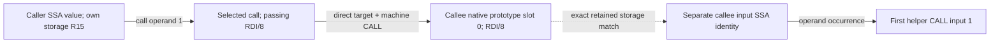

# Native function boundaries as independent facts

The selected cross-function SSH task needs to distinguish recovered formal
prototype entries from raw input varnodes. The existing value is_input flag is
not formal membership: it also includes stack/global inputs. Recovering an
original source signature from either inventory would be unsupported.

A new shared `parameters` query selects native prototype indices, fields and
pages, with a separately projected return descriptor, native model label,
lock/variadic/recovery-error flags and retained Evidence. Defaults omit display
names/type strings. Explicit void, unknown storage/type, known missing native
indices, unavailable store and malformed capture remain distinct. Source arity,
ABI truth, runtime binding, aliases, stack rebasing and split/join mappings stay
unknown. Call-site argument storage is a separate fact. The analyst can compose
it with selected callee prototype/storage/value facts while retaining both
snapshots' identities and the selected machine corroboration.

One native function-prototype owner exports an independent parameters facet.
Its extraction does not depend on full CFG/call enumeration, and optional encoded
output budgeting retains typed omission reasons and readable code. The renderer
restores owned JSON fields by identity rather than a numeric position invalidated
by removing other independent facets. Native address/storage serialization and
JS storage contracts each have one shared owner for call sites and function
prototypes; parameters do not depend on a call-record schema's nested shape.
Shared application admission keeps the same named methods for SDK, CLI and both
MCP adapters. There are seventeen methods, twenty direct tools and four Code
Mode tools. No integration with stock Kuna or other providers is claimed.

The native overlay is pinned to upstream
`fe01d6294eb0d1053ce343c8943646df88e143fc`; the REA experiment was refreshed from
main `f22e8e726` before this change. Forward/reverse patch checks pass against
the pinned base/current source. All generated binaries, captures and caches stay
local. No PR or merge into main is intended.

## Current executed evidence

The first real SSH candidate engine is
`6aae471bef4434eb3acea98b497c6df58e3a9fa71021178c89bbbc3d96109080`.
Actual Code Mode MCP checks both functions, full/selected/empty parameter
queries, paging, exact retained input-location matches, repeated
metadata and complete source fidelity: removing only the added parameters facet
leaves each complete prior native function record unchanged. Banner `0x25cb0`
has four native prototype slots but three retained is_input values; slots 1/2
have no exact retained input match. Caller `0x280c0` has ten prototype slots and
44 raw input values, with all ten native storage tuples matched. Native labels
and flags are observations, not original source arity/ABI proof. Full expected
facts and limits are in the [oracle](function-boundary-oracle.md).

The JS suite passes 94 tests, including projection-only/unavailable/malformed
prototype reads, native identities/order/paging, explicit void versus unknown,
immutable SDK metadata and runtime/JSON Schema agreement. Both actual converted
MCP catalogs pass named schema/admission checks. Two native constructor tests
pass: absent stores stay unavailable, and native slots/void/return storage/locks
remain distinct. Full native workspace/corpus gates are unexecuted.

| Executed stage                        | Family wall s |   CPU s | Kernel peak MiB |
| ------------------------------------- | ------------: | ------: | --------------: |
| Latest-main cached runtime build      |        43.328 |  41.531 |         3,057.8 |
| Initial 94 JS tests                   |        29.271 |   9.085 |            82.1 |
| Initial converted catalog checks      |        10.592 |   2.281 |           136.5 |
| Candidate real Code Mode SSH verifier |         8.676 |   8.439 |           319.9 |
| Candidate opt1 native build           |       447.973 | 414.263 |         2,174.7 |
| Native constructor tests, two passed  |       264.382 | 264.031 |         2,815.2 |

All completed rows have OOM/kill zero and verified payload cleanup, under one
CPU / 4 GiB hard / 3 GiB early-stop bounds. Kernel peaks include charged file
cache, not RSS. JS/schema validation overlapped bounded compilation on the same
CPU and is not an analysis-speed benchmark. The initial native build accidentally
selected default release optimization rather than the original opt1 profile; it
was deliberately interrupted after 135.878 seconds and its unique owned scope
verified inactive. Its final counters are unavailable. The corrected opt1
candidate build above completed; no interrupted build is reported as passing.

## Final native and public-boundary checks

The final engine is
`770ac3f2e66f23bfb825cb7b7231ccd9996837ea90a0f7f1cd48a8a47334f047`,
version 0.1.0, release opt1 with embedded specs. The committed full overlay hash
is `20ded012973157412706efc5b1834f9d6530a9e98e9e3bdc26ab34120ac7bac0`.
The complete native source still exactly matches that patch after building.
The earlier candidate's prototype facts and the final engine agree, and both
actual MCP routes independently reproduce the same full native boundary facts.
All prior function fields remain equal to the old complete goldens.

Thirteen native JSON producer tests pass, including the three new cases:
oversized parameters preserve established graph/call coverage in the fixture;
small independent parameters are reclaimed after graph/call omission; restoring
fields after other removals uses identity rather than a stale array position.
The two constructor tests and these JSON tests are focused runs; the complete
native library, CLI, workspace, stage and corpus gates are not claimed.

Real zlib SDK reads preserve cached metadata/storage against caller mutation.
The real CLI composes snapshot and a selected parameter/return read. Separate
real SDK checks use the old `a9ca8a8a...` experimental engine and upstream stock
1.833 (`d858918b...`): unavailable parameters are explicit, linked to the retained
Evidence, and code stays readable. The old native capture reports not-captured;
stock lacks the experimental capability. Neither fabricates a zero-entry
prototype. All three use explicitly pinned local engines, without global setup.

| Additional executed stage             | Family wall s |   CPU s | Kernel peak MiB |
| ------------------------------------- | ------------: | ------: | --------------: |
| Native JSON tests, 13 passed          |       315.129 | 314.664 |         2,138.6 |
| Final native runtime build            |       102.590 | 102.370 |           621.6 |
| Final Code Mode SSH verifier          |         8.778 |   8.527 |           324.2 |
| Final direct SSH verifier             |         9.690 |   9.319 |           300.4 |
| Final JS suite, 94 passed             |        16.707 |  12.217 |            83.3 |
| Final converted schema/catalog check  |         5.392 |   3.856 |           134.8 |
| Real final-engine zlib SDK            |         3.665 |   2.782 |           113.8 |
| Real old-native SDK unavailable check |         5.081 |   3.420 |           125.9 |
| Real stock SDK unavailable check      |         4.178 |   2.983 |           101.0 |
| Real zlib CLI                         |         4.006 |   2.907 |           118.5 |

All have OOM/kill zero and verified payload cleanup under the same one-CPU,
4 GiB hard / 3 GiB early-stop controls. Kernel peaks include charged file cache,
not RSS. These are check/build observations with uncontrolled host conditions,
not proof of native analysis acceleration. Final JS/schema checks cover the
shared storage refactor and the native admission helper shared by existing
values/calls/switches/blocks/path and the new method. Lint has no warnings and
all changed-file formatting passes. Full REA production gates are unexecuted.

## Frozen real-model protocol and results

The [question](function-boundary-question.txt), [oracle](function-boundary-oracle.md)
and complete runtime/HEAD were frozen at
`5ca00675b7fe487ba991c6fc6cd09ae67a7af24c`. The question starts from two formats,
with no addresses/counts/native IDs/paths. Both enabled-tool manifests come from
the actual SDK catalog: twenty direct tools or four Code Mode tools. The exact
prompt and runtime source digests match between lanes; common discovery,
envelope/stopping and wait guidance is identical, with each lane's exact names.
Order is direct then Code Mode, using fresh isolated leases/private native
caches. Requested model/settings are `gpt-6.1-sol/high`, Codex 0.161.0. OS/model
caches, host contention, remote compute and the resolved service model build are
uncontrolled/unmeasured. This is a new question stratum, not a before/after
comparison with the earlier guard/warning question or a traditional-provider
cell for facts its selected interface does not expose.

Both complete answers pass agent review against the frozen criteria. They find
both owners from references, report the 4/10 native entries versus 3/44 raw
inputs, preserve every exact tuple/value-ID match and the two missing banner
matches, distinguish explicit void from null storage, and retain native model,
lock/error/hidden/indirect flags without claiming original source arity/ABI.
They correctly connect the selected caller operand through passing storage to
the callee's native entry/input and first helper, keeping the SSA IDs separate,
with focused machine corroboration and explicit stack/alias/runtime limitations.
Neither calls `code` or parses a C declaration. Each uses one capture per
selected function. Both close the lease.

Scripted checks verify every cited source's bytes/hash and target/engine identity,
complete prior native function fidelity except the added parameters facet,
prototype metadata/entries/output, raw input counts and all native tuple matches.
Direct cites nine observed sources; Code Mode cites ten. Full-answer grading is
primary-agent review, not a human declaration or automated language grading.
API lease handles expire on close; the explicitly requested raw Evidence
files remain available locally for the recorded source audit.

| Whole-task measure              | Direct atomic | Code Mode |
| ------------------------------- | ------------: | --------: |
| Cumulative input tokens         |       331,674 |   359,789 |
| Included cached input           |       282,624 |   319,232 |
| Uncached input                  |        49,050 |    40,557 |
| Output tokens                   |         4,848 |     5,564 |
| Included reasoning output       |           766 |       702 |
| Observed model responses        |            12 |        13 |
| Client executions / waits       |        11 / 0 |    12 / 0 |
| MCP attempts                    |            23 |        12 |
| Fact reads                      |            20 |        26 |
| Parameter reads, included above |             2 |         4 |
| Rejected MCP / inner API reads  |         0 / 0 |     0 / 0 |
| Model wall seconds              |       118.393 |   125.730 |
| Family wall seconds             |       119.210 |   126.269 |
| Family CPU seconds              |        18.682 |    18.944 |
| Kernel process-family peak MiB  |         676.1 |     670.8 |

Per-response usage sums match the ledgers. Cached input is included in input;
reasoning is included in output. Discovery, schemas, extra reads and waiting
remain charged. Both actual clients already expose JavaScript execution despite
the configured feature flags, so this compares MCP adapters within that common
client surface. Every runtime/target/engine fingerprint remains unchanged;
both families have OOM/kill zero, verified payload cleanup and removed private
profiles. Code Mode actually invokes the guest executor and native fact APIs.

Code Mode uses fewer MCP requests and less uncached input, but more cumulative
input/output/responses, more fact reads and slightly more wall/CPU time. Its
local peak memory is slightly lower. It rereads selected parameter storage
inside a later guest program for a join; these are cached fact reads, not extra
native captures. These mixed costs do not establish a stable adapter advantage,
a causal speedup, original native-prototype accuracy or broad complex-software
superiority. No failed or under-equipped model attempt is silently discarded.

## What the composition requires

The selected caller value itself is at native `register:0xb8/8`, while the call
passes it in `register:0x38/8`. Joining the caller value's own coordinate directly
to the callee prototype would miss the real connection. The useful reusable
facts are distinct: the value identity/storage, its call operand occurrence,
that occurrence's passing location, the selected direct target, the callee's
recovered prototype entry and its retained input value/use. Machine instructions
corroborate the selected transfer; matching coordinates alone are not equality.

The prototype inventory and raw input inventory are also different fact sets.
Their native IDs, roles, widths, recovery authority and source scope must survive
composition. More granular JSON alone cannot supply that meaning. This experiment
now exposes those distinctions and demonstrates correct composition by two real
models on the stripped SSH artifact, while keeping original signatures, generic
interprocedural aliases, stack rebasing and full machine-flow recovery unknown.

Raw local records include `parameters-*`, `ssh-boundary-{direct,codemode}-v1*`,
`boundary-model-costs.json`, `boundary-answer-checks.json` and
`boundary-answer-review.json` under `.cache/atomic-codemode/`. No binaries,
provider project files, dependencies, private profiles or local check scripts
are committed. No PR/main merge or integration readiness is claimed.

## Post-model malformed-facet hardening

Final source review found a related admission bug: the outer function schema
validated every `*_error` as text before the independent facet reader ran.
A malformed child failure value could therefore reject the whole function,
losing valid code or unrelated graph/prototype facts. The new parameter field
had copied that existing coupling. This is deterministic malformed-boundary
reproduction, not an observed failure emitted by the real Rust engine.

The parent now admits opaque child error values; the single shared facet owner
validates a present reason as text and returns its tagged failure locally.
Graph Evidence access reuses that owner when the graph is absent instead of
reinterpreting raw failure values. Identity, function count, code and entry/input
admission remain parent responsibilities. Complete source Evidence is preserved.
There is no second failure parser or silent conversion of bad values to absence.

Replaying the old parent decoder from `5ca00675b` with the same failing path
rejects all 25 malformed fixtures (five facets, five non-text reason shapes).
The current decoder preserves code in all 25. Regression cases also retain a
healthy graph/source view for unrelated malformed facets, and a healthy prototype
when the graph's failure value is malformed. The new negative test has its own
small module instead of expanding the already large IR-semantic test file.

The 95-test suite passes (4.850 family wall / 4.639 CPU seconds / 84.9 MiB),
followed by the focused eight-case files after moving that new test (1.025 /
0.833 / 61.1). Both real SSH MCP routes repeat successfully on the hardened
source and preserve every previously verified native boundary fact and complete
old-function fidelity. Their Code Mode/direct families cost 8.677 / 8.467 /
321.5 MiB and 8.475 / 8.183 / 299.6 MiB respectively; all completed checks have
OOM/kill zero and verified cleanup. The engine/patch are unchanged.

After moving the new test, the complete explicit Node glob again passes all 95
cases (5.052 family wall / 4.857 CPU seconds / 82.6 MiB). The repository's
`verify:test-discovery` inventory check also passes: 1,441 files discovered once
(1.328 / 0.988 / 150.5 MiB). That inventory check does not execute those files;
the experiment's executed test scope is the explicit Node suite above.

The real-model table remains pinned to the earlier `5ca00675b` runtime; those
models were not rerun after this malformed-input-only change. Post-hardening
module/public-provider checks do not become new model measurements. Local
reproduction/check receipts are `parameters-facet-before-after*`,
`parameters-facet-failure-*`, `parameters-hardened-*` and the final test/discovery
records. The full repository/native gates remain unexecuted.
